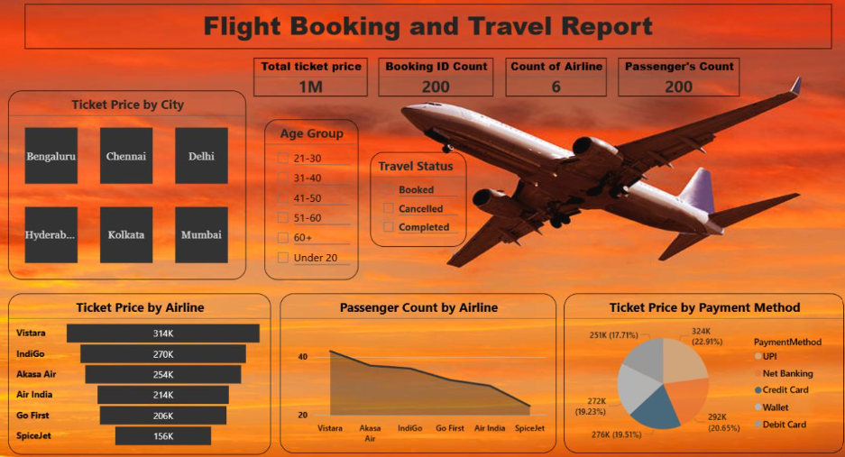

# Flight Booking and Travel Report

## Overview
An interactive Power BI report on flight bookings across six airlines and six cities.

**Tools:** Power BI

## Dataset
200 bookings across 6 airlines and 6 cities (Bengaluru, Chennai, Delhi, Hyderabad, Kolkata, Mumbai).

## What I did
- Built an interactive Power BI report on the booking data.
- Visualised ticket price by city, airline and payment method, plus passenger count.
- Added Age Group and Travel Status slicers.

## Key insights
- About 1M in total ticket sales from 200 bookings.
- Vistara earns the most (314K), then IndiGo (270K) and Akasa Air (254K); SpiceJet earns the least (156K).
- UPI is the top payment method at 324K (22.91%).

## Files
- flight_booking_report.pbix
- images/dashboard.png  (screenshot)

## Author
Adigouni Moksha Prasad Goud · [LinkedIn](https://www.linkedin.com/in/adigouni-moksha-prasad-goud-957b97292) · amokshaprasad@gmail.com
